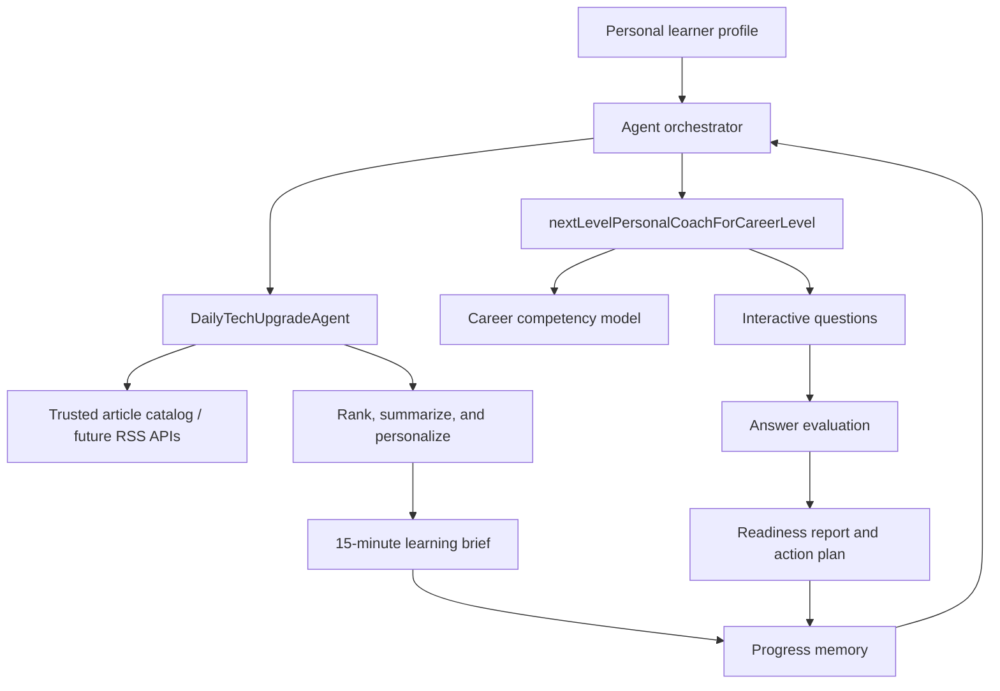

# Architecture

## Shared workflow

## Agent 1 workflow

1. Load interests, growth areas, career goal, and daily time.
2. Read candidate article metadata and summaries.
3. Score overlap between article topics and the learner profile.
4. Select the top three.
5. Present dates, sources, URLs, summaries, takeaways, career connections, and reading time.
6. Ask a reflection question that can become progress memory.

## Agent 2 workflow

1. Load the target internship and competency model.
2. Ask questions about coding, data quality, ML, healthcare AI, and RAG.
3. Compare answer text with competency indicators.
4. Produce per-skill feedback and a 1-5 readiness score.
5. Identify strengths and gaps.
6. Generate a practical improvement plan.

## Tools, sources, and memory

- Current tools: Python standard library, public RSS feeds, public web search, local JSON profile, and command-line interaction.
- Intended next tools: OpenAI or another LLM for verified summaries, structured job-board APIs, and a vector store for article or resume retrieval.
- Current memory: `user_profile.json` and the current coaching session.
- Intended persistent memory: article history, completed exercises, previous scores, and reflections.

The prototype uses dynamic retrieval first and deterministic fallbacks second. This keeps the workflow usable during a demo while still satisfying the assignment's requirement to discover relevant technical and career information.
